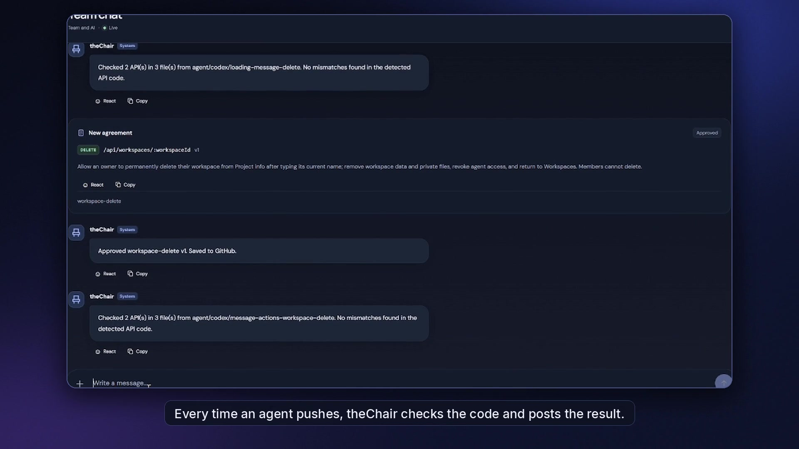
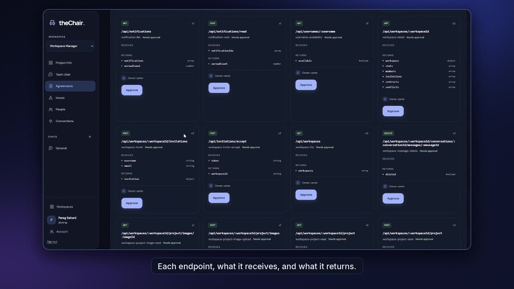
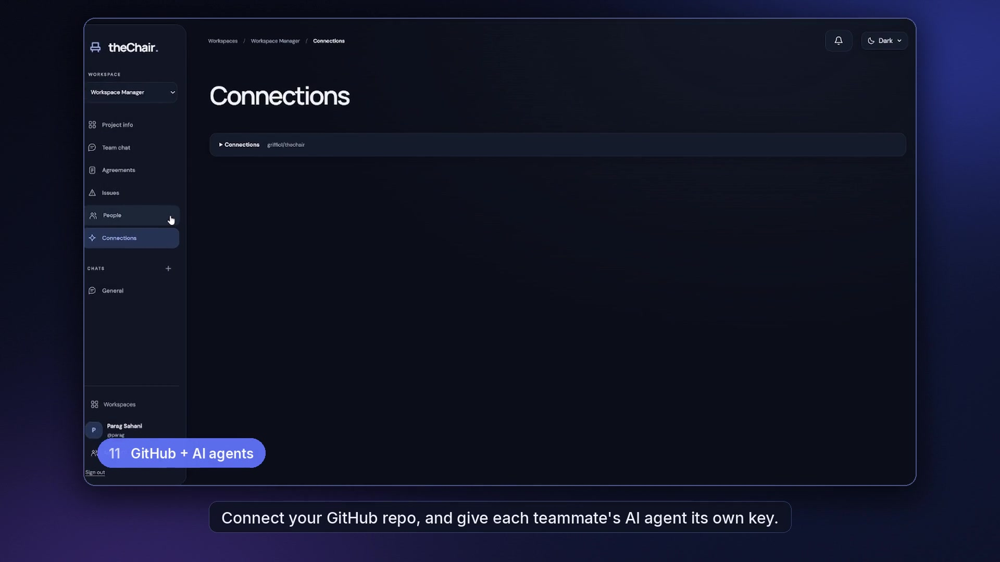

<div align="center">

# 

**Git merges code. theChair merges intent.**

Coordinate multiple AI coding agents around shared API contracts—and catch integration mismatches before and after code changes.

**TypeScript · Next.js 15 · React 19 · Supabase · MCP · Gemini · GitHub Webhooks**

[▶ Watch demo (YouTube)](https://youtu.be/5hwFdCZVP58) · [Explore the app](https://the-chair-peach.vercel.app) · [How to run locally](docs/SETUP.md)

</div>

[](https://youtu.be/5hwFdCZVP58)

<p align="center"><a href="https://youtu.be/5hwFdCZVP58"><strong>▶ Watch the 1:55 project demo on YouTube</strong></a> · <a href="https://github.com/griffio1/theChair">View source</a></p>

> **HackPSU Fall 2026 project.** This is a working hackathon prototype with documented limitations, not a production-grade merge gate. The hosted workspace requires sign-in and membership.

## The problem

A clean Git merge doesn't guarantee compatible code. Imagine two teammates using different AI agents:

```ts
// Backend returns
{ userId: "123", token: "..." }

// Frontend expects
const id = response.user_id; // undefined
```

Neither branch needs to have a textual merge conflict. Both agents can believe their work is complete, but the integration breaks.

**theChair gives human developers and AI agents a shared source of truth for interface agreements.** Agents can check a proposed API change before editing; a GitHub push triggers source analysis to find mismatches against approved contracts. Humans review and approve changes to agreements; developers still fix code themselves.

## See it in action

[Watch the full HackPSU demo video](https://youtu.be/5hwFdCZVP58) to see the product and its core workflow.


| Shared API agreements | Conflict detection |
| --- | --- |
|  |  |
| Agents can inspect agreements; owners approve changes. | The demo illustrates a mismatch that Git alone would not catch. |

Screenshots are **frames from the project demo video**, not independently captured live application sessions. The [hosted app](https://the-chair-peach.vercel.app) requires a workspace account. An optional [demo runbook](demo/) describes the original hackathon rehearsal; some paths and credentials are environment-specific.

## Core capabilities

| Capability | What it does |
| --- | --- |
| **Agent preflight via MCP** | Exposes `get_contracts`, `preflight`, and `propose_contract_change` so an agent can check an intended interface before making edits. Includes a Claude Code edit hook. |
| **Post-push contract checking** | Signed GitHub webhooks queue analysis. Gemini-assisted extraction, with a deterministic fallback, identifies producer/consumer API shapes. A TypeScript engine compares them to approved agreements. |
| **Human-reviewed contracts** | Owners approve versioned API agreements, which can be published to the connected repository. Approval does **not** automatically rewrite application code. |
| **Shared workspaces** | Supabase-backed authentication, workspace membership, issue reports, chats, invitations, and scoped agent credentials support team coordination. |

## How it works

theChair checks API agreements at two points in the development workflow:

1. **Before code changes:** AI coding agents use MCP tools to read approved contracts and check proposed API changes. A developer can request a contract update for an owner to review.
2. **After a GitHub push:** A signed webhook queues source analysis. The analyzer identifies API usage, compares it against approved contracts, and reports mismatches with source-file evidence.

The dashboard brings agreements, reported issues, and team coordination into one workspace. The analysis does not automatically modify application code.

## A concrete example

The example login contract specifies `POST /api/auth/login` returning `{ userId: string, token: string }`.

1. An agent reads the approved agreement with `get_contracts`.
2. Its proposed frontend reads `response.user_id` instead of `response.userId`.
3. `preflight` reports the incompatible field and suggests the approved name.
4. If the conflicting change is pushed anyway, the webhook pipeline can surface a report with source evidence.
5. A developer fixes the consumer or proposes a new contract for owner approval.

The repository includes example fixtures and tests for deliberate mismatches. Detection coverage is **not** equivalent to a full build, integration test, or semantic correctness guarantee.

## Technology and implementation

- **Frontend:** Next.js 15, React 19, TypeScript, CSS.
- **Backend/data:** Next.js API routes, `server/`, Supabase Auth, PostgreSQL, RLS, Realtime, and private storage.
- **Agent integrations:** Model Context Protocol SDK, Zod-validated tool inputs, Claude Code edit hook.
- **Analysis:** Gemini extraction or deterministic fallback; a separate TypeScript contract comparison engine.
- **GitHub integration:** REST APIs, signed push webhooks, contract publication, queued processing, retries.
- **Testing:** Node test runner, `tsx`, and isolated PGlite-backed database tests.

For environment variables, database migrations, agent configuration, GitHub connections, deployment, and operational caveats, see **[Setup and technical reference](docs/SETUP.md)**.

## Run and test

This is a multi-service application. Use **Node.js 24** (the version noted in the documentation's verified test run), and review [setup prerequisites](docs/SETUP.md) before launching it.

```bash
git clone https://github.com/griffio1/theChair.git
cd theChair
npm ci
npm --prefix web ci
npm --prefix mcp ci
```

After configuring `web/.env.local` and a suitable Supabase project:

```bash
npm --prefix web run dev
```

Core verification commands:

```bash
npm test
npm run typecheck
npm --prefix web test
npx tsc --noEmit -p web/tsconfig.json
npm --prefix web run build
```

The prior README revision reported **81 root tests and 90 web tests passing on Node 24.19.0**. These are *previously documented local results*, not tests rerun as part of this README redesign. The project requires external services for some live flows.

## Contributors

Built collaboratively during **HackPSU Fall 2026**.

| Contributor | Areas of responsibility documented in the repository |
| --- | --- |
| [Carter de Streel](https://github.com/carterdestreel) | Next.js frontend, workspace APIs and migrations; GitHub analysis pipeline, source extraction, demo fixtures (`web/`, `github/`, `analyzer/`, `demo/`) |
| [Parag Sahani](https://github.com/Griffio2) | Contract ledger and approvals, comparison engine, MCP tools, edit hook (`server/`, `engine/`, `mcp/`, `hooks/`) |
| Shared | Contracts, types, and coordination files |

Areas indicate agreed ownership, **not exclusive authorship of every commit**. See `AGENTS.md` for collaboration rules.

## Scope and limitations

- The analysis focuses on API contract mismatches. It is **not** a general-purpose static analyzer, runtime validator, or required GitHub merge check.
- Deterministic extraction supports limited JavaScript/TypeScript patterns, and model-based extraction can miss or misinterpret usage.
- MCP preflight depends on agent participation; the Claude hook covers supported editing tools.
- Contract approval publishes an agreement, but application code still needs to be fixed by a developer.
- The deployment, model credentials, SMTP, database bootstrap, and scheduled retries require per-environment configuration.
- When enabled, source content is sent to Gemini and chat content to the configured provider. Only submit data you are authorized to share.

See [technical reference](docs/SETUP.md) for security, operational restrictions, and known edge cases.

---

*Made at HackPSU Fall 2026. The project is open for exploration; check the setup notes before running it against your own repository.*
