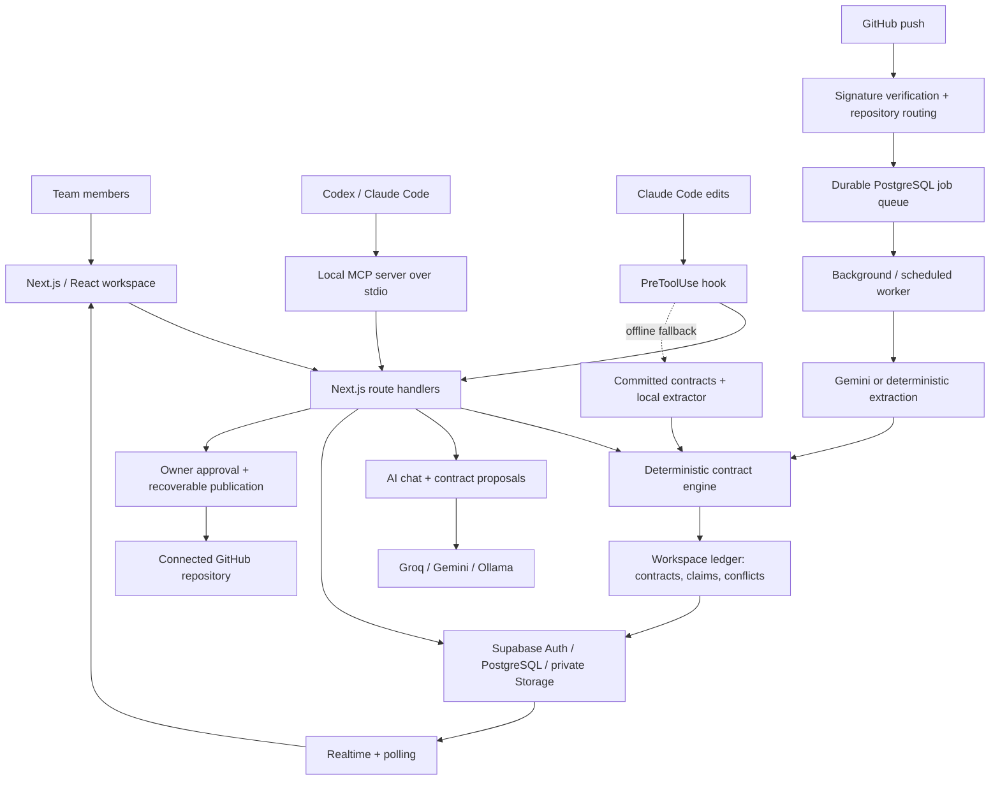

# theChair

**Shared API agreements for teams building with multiple AI coding agents.**


Git can merge two files successfully even when they disagree about an API. A backend returns `userId`; a frontend expects `user_id`. Neither developer sees a merge conflict, but the application breaks.

theChair gives people and their coding agents a shared, versioned record of API agreements. It checks an agent's proposed changes **before editing** and analyzes source **after a GitHub push**, reporting mismatches with file evidence and suggested fixes. Humans approve contract changes; developers apply the corresponding code changes.

Built at **HackPSU Fall 2026** by Carter and Parag.

## Demo

[](https://youtu.be/5hwFdCZVP58)

**[Watch the demo](https://youtu.be/5hwFdCZVP58)** ? [Hosted app](https://the-chair-peach.vercel.app) ? [Demo runbook](demo/RUNBOOK.md)

The landing page is public. The workspace application requires sign-in and membership. The runbook documents the login-contract rehearsal and recovery commands; its branch names and workspace references belong to the original hackathon environment.

<details>
<summary>Screenshot placeholders</summary>

| Screenshot to add | What it should show |
| --- | --- |
| Team chat and agreements | A proposed API agreement alongside team discussion |
| Contract mismatch | A field mismatch, source evidence and suggested correction |
| Project info | Workspace overview and optional hackathon countdown |

<!-- Replace these placeholders with sanitized screenshots. Do not include tokens, private conversations or environment files. -->

</details>

## Key features

- **Checks before edits.** MCP tools expose approved contracts, evaluate proposed API shapes and warn about overlapping file claims. A Claude Code hook checks proposed file content and can fall back to committed contracts when the API is unavailable.
- **Checks after pushes.** Signed GitHub webhooks enqueue source analysis. Gemini extracts producer/consumer shapes; a deterministic extractor provides an offline mode and fallback. A pure TypeScript engine compares methods, paths, fields and known types against approved contracts.
- **Human-controlled agreements.** Owners approve proposals. The publishing workflow writes contract JSON and the generated agreement section in `AGENTS.md` to the connected repository using one Git commit, with saved state for retry and recovery.
- **Workspace isolation.** Supabase Auth, PostgreSQL row-level security and server-side membership checks scope chats, agreements, issues, repository connections and agent credentials. Agent tokens are hashed, expire and can be revoked.
- **Team workspace.** Persistent chats, @username invitations and an invite inbox, Markdown project descriptions, private images, reactions, copy/delete actions, account settings and an optional hackathon countdown. Owners can delete workspaces after confirming their name.
- **Failure handling.** Duplicate push deliveries use stable identifiers; saved jobs have leases and retries. Database-enforced usage limits, bounded AI calls and validated extraction responses constrain work and keep malformed model output out of the contract engine.

## Architecture



The backend lives in `server/` and is invoked by Next.js API routes, rather than running as a separate Express service. `AsyncLocalStorage` carries the verified workspace through ledger and GitHub operations. Browser database reads use RLS; privileged server operations verify membership or scoped agent credentials first.

Extraction and comparison are separate: a model identifies API usage, while `engine/` makes the comparison. Extraction caches incorporate the workspace context, source content, commit, model, mode and prompt version. Pushes are persisted before HTTP 202 is returned; that response acknowledges receipt, not a completed check.

## Tech stack

| Technology | Role |
| --- | --- |
| TypeScript, Node.js | Shared types, contract engine, integrations and tooling |
| Next.js 15, React 19, CSS | Landing page, workspace UI and server route handlers |
| Supabase / PostgreSQL | Authentication, RLS, transactional functions, ledger, queues and Realtime |
| Supabase Storage, Sharp | Private images; decode, normalize to WebP and strip metadata |
| MCP SDK, Zod | Local agent tools and input schemas |
| Gemini API | Schema-constrained extraction of API usage from source |
| Groq / Gemini / Ollama | Configurable text-chat provider and contract-proposal tool calls |
| GitHub APIs and Actions | Source retrieval, signed push delivery, contract publication, CI and scheduled retries |
| Node test runner, tsx, PGlite | TypeScript tests and isolated PostgreSQL policy/transaction tests |
| Vercel | Next.js deployment configuration |

## How it works

The checked-in [`auth-login` contract](contracts/auth-login.json) defines:

```text
POST /api/auth/login
Request:  { email: string, password: string }
Response: { userId: string, token: string }
```

1. An agent calls `get_contracts` before working on login.
2. Its proposed frontend reads `data.user_id` and `data.token`.
3. `preflight` compares that consumer shape with the approved response and returns a **block** for `user_id`, recommending `userId`.
4. If incompatible code is pushed without that check, the GitHub pipeline extracts its usage and records a conflict with source-file evidence.
5. The developer corrects the code and checks again. If the API itself should change, an owner approves a new contract version instead.

The current [backend](demo/server/index.ts) and [frontend fixture](demo/web/Login.tsx) both use `userId`. Tests exercise deliberate mismatches. Approval does **not** automatically repair application code, and a successful source check does not prove the whole application is correct.

## Getting started

### 1. Install dependencies

Use **Node.js 24**, matching CI. The locked Supabase client requires Node 22 or newer; the earlier Node 20 setup is no longer sufficient for all installed dependencies.

```sh
git clone https://github.com/griffio1/theChair.git
cd theChair
npm ci
npm --prefix web ci
npm --prefix mcp ci
```

Create `web/.env.local` from [`.env.example`](.env.example) only if it does not already exist. In PowerShell:

```powershell
if (!(Test-Path web/.env.local)) { Copy-Item .env.example web/.env.local }
```

The local file is gitignored. Never put server secrets in `NEXT_PUBLIC_` variables.

### 2. Configure services

| Variables | Purpose |
| --- | --- |
| `SUPABASE_URL`, `SUPABASE_SERVICE_KEY` | Server-side Supabase URL and secret/service key |
| `NEXT_PUBLIC_SUPABASE_URL`, `NEXT_PUBLIC_SUPABASE_ANON_KEY` | Browser URL and publishable/anon key; the code also accepts `NEXT_PUBLIC_SUPABASE_PUBLISHABLE_KEY` |
| `LLM_PROVIDER`, provider key/model | Chat provider; the template uses `groq` with `GROQ_API_KEY` and `GROQ_MODEL` |
| `EXTRACTOR`, `GEMINI_API_KEY`, `GEMINI_MODEL` | `auto`, `gemini` or `deterministic`; deterministic extraction needs no model key |
| `THECHAIR_API_URL` | API origin for MCP and hooks, usually `http://localhost:3000` locally |
| `THECHAIR_PUBLIC_URL` | Optional canonical origin for shared invitation and webhook URLs |
| `GITHUB_REPO` | Identifies theChair's own repository for demo-specific source exclusions |
| `NEXT_PUBLIC_TURNSTILE_SITE_KEY` | Optional CAPTCHA; configure its secret and enforcement in Supabase Auth |
| `CRON_SECRET` | Private, random 32+ character secret for scheduled jobs |

Start with `LLM_PROVIDER=groq` and `EXTRACTOR=auto`, or use `EXTRACTOR=deterministic` to exercise extraction without Gemini. Choose an available `GEMINI_MODEL` from [Google's model list](https://ai.google.dev/gemini-api/docs/models); template defaults and older deployment notes are not guarantees of model availability. Ollama is an explicitly selected provider, not an automatic chat fallback.

Repository tokens and webhook secrets are configured per workspace in **Connections**. The global `GITHUB_TOKEN` and `GITHUB_WEBHOOK_SECRET` entries retained in the template do not replace that connection.

### 3. Prepare Supabase

Use an already configured project, or follow the fresh-database sequence below. Configure Auth email confirmation, site URL and allowed `/workspaces` and `/recover` redirects for your origin. SMTP and optional Turnstile must be tested in your own environment.

**Do not blindly rerun historical migrations on an existing database.** They evolve the original single-team demo into a multi-workspace application; `secure-team.sql` contains an explicit hackathon workspace binding.

<details>
<summary>Fresh-database migration sequence and bootstrap requirements</summary>

1. Apply [`supabase/schema.sql`](supabase/schema.sql), then [`web/sql/workspaces.sql`](web/sql/workspaces.sql) in Supabase's SQL Editor.
2. Create the intended owner's Auth account and bootstrap its initial workspace using `chair_create_workspace` with that user's authenticated identity. Record the workspace UUID. This is a manual bootstrap step; the current application expects the remaining migrations to be installed.
3. Review a local copy of [`secure-team.sql`](web/sql/secure-team.sql) and replace its hard-coded `target` with that explicitly chosen workspace UUID before running it. This assigns the seeded legacy ledger to its owner; do not assign existing data to an arbitrary account.
4. Apply these files from `web/sql/`, in order:

```text
workspace-teams.sql
workspace-roles.sql
chat-images.sql
chat-reactions.sql
production-limits.sql
webhook-jobs.sql
approval-publishing.sql
account-profiles.sql
project-info.sql
usernames-inbox.sql
message-delete.sql
workspace-delete.sql
```

The base schema enables Realtime for ledger tables. Apply the full sequence before exposing the app: the base schema alone still has the original demo read policies. Do not rerun `secure-team.sql` after `workspace-teams.sql`, because it reinstates older single-team policies.

See [workspace setup](web/WORKSPACE-TEAMS.md) for the data model and legacy binding. Some historical handoff sections describe earlier milestones; the sequence above includes the newer profile, project, username and deletion migrations. A clean Supabase bootstrap has not been re-executed for this README revision.

</details>

### 4. Run locally

```sh
npm --prefix web run dev
```

Open [localhost:3000](http://localhost:3000). Sign up, confirm your email, choose a username and create or join a workspace. The original `/team` alias depends on the legacy binding; new projects use `/workspaces`.

In a second terminal, start the small Express fixture if rehearsing the demo:

```sh
npm run demo:server
```

It listens on port 4000. The fixture's login is separate from Supabase sign-in; its React file is extraction/demo source, not a standalone frontend deployment. See the [runbook](demo/RUNBOOK.md) for sample requests and safe rehearsal branches.

### 5. Connect agents and GitHub

An owner opens the workspace's **Connections** page and creates a named agent credential. The token is shown once, scoped to that workspace, expires after 30 days and cannot approve agreements. Supply it privately to the agent process; the MCP server does not automatically load `web/.env.local`.

Example Codex configuration in `~/.codex/config.toml`:

```toml
[mcp_servers.thechair]
command = "npx"
args = ["tsx", "/ABSOLUTE/PATH/theChair/mcp/server.ts"]
env = { THECHAIR_API_URL = "http://localhost:3000", THECHAIR_AGENT = "codex", THECHAIR_DEVELOPER = "your-name", THECHAIR_AGENT_TOKEN = "<private-agent-credential>" }
```

Use an absolute path; forward-slash Windows paths work in TOML. Restart the client and call `get_contracts`. Claude Code can register the same stdio server with its own credential and `THECHAIR_AGENT=claude-code`. The repository's [hook configuration](.claude/settings.json) checks Edit/Write/MultiEdit; give the hook `THECHAIR_API_URL`, `THECHAIR_DEVELOPER` and `THECHAIR_AGENT_TOKEN`. Its offline fallback uses local `contracts/*.json` and cannot see teammates' live file claims.

For GitHub, an owner supplies `owner/repository`, a repository-scoped token with Contents read/write permission and repository admin/push access, and a random webhook secret of at least 32 characters. Configure the repository webhook manually with the URL shown in Connections, JSON content type, push events and the same secret. One repository is connected to one workspace; connecting it does not create the GitHub webhook.

### 6. Deploy and enable retries

For Vercel, select **Next.js**, set Root Directory to **`web`**, and include source files outside the root in the build. Use `npm ci` and `npm run build`, and configure the environment variables on that project.

The [scheduled workflow](.github/workflows/retry-checks.yml) calls `/api/internal/jobs` every five minutes when enabled. Configure:

- Vercel `CRON_SECRET` and GitHub Actions secret `THECHAIR_JOB_SECRET` with the same private value.
- Repository variable `THECHAIR_JOB_URL` with your deployment's `/api/internal/jobs` URL.
- Repository variable `THECHAIR_JOB_RUNNER_ENABLED=true`.

The worker retries saved checks and processes queued workspace-file cleanup. Scheduling depends on GitHub Actions configuration; it is not enabled by installing dependencies. See [deployment notes](web/DEPLOYMENT.md), using the current per-workspace connection flow and model selection described above.

## Testing and development

From the repository root:

```sh
npm test
npm run typecheck
npm --prefix web test
npx tsc --noEmit -p web/tsconfig.json
npm --prefix web run build
```

The root suite covers extraction, contract comparison, webhook processing and proposal validation. Web tests include PGlite-backed RLS and transaction checks, workspace isolation, invitations, image access, retries and deletion. They use isolated databases and mocked service calls rather than the shared application database.

**Verified for this README revision on Node 24.19.0:** 81 root tests and 90 web tests passed; root and web TypeScript checks passed. The [CI workflow](.github/workflows/ci.yml) also installs all three dependency sets, builds the web app and runs dependency audits. These are verification results, not performance or production-readiness metrics.

Stop the local Next.js dev server before running a build: both use `web/.next`. Installation and production build commands are preserved from the manifests/CI; they were not rerun for this documentation-only change.

<details>
<summary>Optional live integration checks</summary>

These commands require matching API and Supabase configuration in the private env file. Workspace checks create and remove disposable accounts/data; Gemini extraction makes real model calls. `WORKSPACE_CHECK_URL` overrides the default localhost API. Review each script before running it against a shared environment.

```sh
node --env-file=web/.env.local --import tsx web/scripts/check-workspaces.ts
node --env-file=web/.env.local --import tsx web/scripts/check-workspace-teams.ts
node --env-file=web/.env.local --import tsx web/scripts/check-team-access.ts
node --env-file=web/.env.local --import tsx web/scripts/check-chat-images.ts
node --env-file=web/.env.local --import tsx web/scripts/check-project-info.ts
node --env-file=web/.env.local --import tsx web/scripts/check-usernames-inbox.ts
node --env-file=web/.env.local --import tsx web/scripts/check-message-delete.ts
node --env-file=web/.env.local --import tsx analyzer/check-gemini.ts
```

</details>

## Background and contributors

Built at **HackPSU Fall 2026** to address a coordination problem in AI-assisted team development: separate coding agents can produce individually plausible code while relying on incompatible interfaces. The project connects agent tools, source analysis and a shared human approval workflow around that problem.

Responsibilities below follow the repository's [AGENTS.md](AGENTS.md) ownership agreement; they describe directory responsibility, not exclusive authorship of every commit.

| Contributor | Responsibility | Paths |
| --- | --- | --- |
| Carter, Builder B | Frontend, API routes and workspace migrations; GitHub push pipeline, extraction and demo fixtures | `web/`, `github/`, `analyzer/`, `demo/` |
| Parag, Builder A | Backend ledger and approvals, contract engine, MCP server and edit hook | `server/`, `engine/`, `mcp/`, `hooks/` |
| Shared | Types, approved contract files and coordination documents | `shared/`, `contracts/`, `AGENTS.md`, `DECISIONS.md` |

Before contributing, read `AGENTS.md`: call `get_contracts` and `preflight` before API work, coordinate directory ownership, and propose contract changes for human approval. Branches use `agent/<tool>/<topic>`.

## Limitations and next steps

- **Detection coverage:** the deterministic extractor recognizes limited JavaScript/TypeScript source patterns; Gemini can also miss or misinterpret usage. This is contract checking, not general semantic verification, a runtime validator or an enforced GitHub merge gate.
- **Human workflow:** MCP checks depend on agents invoking them. The Claude hook adds enforcement for its supported edit tools. Approval publishes agreements, not automatic source fixes; earlier conflict cards remain history after a corrected push.
- **Operational setup:** fresh-database bootstrap is manual. SMTP, CAPTCHA enforcement, scheduled retries, hosted availability and model credentials must be verified per deployment. Ambiguous approval publication may require operator review.
- **Chat/data scope:** attachments are for teammate viewing, not AI image understanding. Text-only AI-chat retries can duplicate the human message after a failure. Historical team messages without verified author IDs cannot safely expose author-only deletion. Account deletion still requires support; workspace deletion is self-service for owners.
- **Future improvements, not implemented commitments:** an automated database bootstrap, broader parser coverage, idempotent AI-chat sends, self-service account deletion and a reproducible browser regression suite.

Source sent to Gemini and conversations sent to the selected hosted chat provider leave the application. Use code and data your team is authorized to share. Private configuration, agent tokens and repository credentials must stay out of chat, screenshots and commits. Invitations use the in-app inbox or manually shared links; the app does not send invitation emails. Account/data support: paragsahani60@gmail.com.
